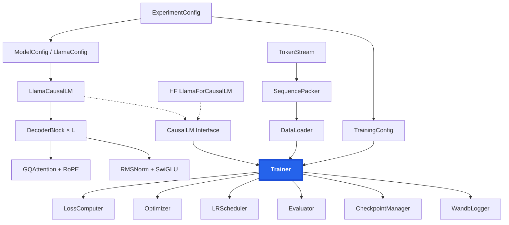

# scaling-llama-3-2

A mostly handwritten training stack for Llama 3.2–style language models. We use it for **Lab 6: Predictable Scaling**. The goal is to develop a training recipe through small-scale experiments, check that it transfers to larger runs, and then train a **1B model from scratch on 200B tokens of FineWeb-Edu**. The target is the lowest possible perplexity, along with an accurate forecast of that perplexity.

The stack is meant to outlive this lab. Both members of the pair should be able to explain every component: model, optimizer, data loading, packing, loss and checkpointing.

> **Status:** early scaffolding. The interfaces and architecture are defined below, and most components are not implemented yet. See [Components](#components) for each component's status.

---

## Architecture

The stack uses the same interfaces as HuggingFace Transformers. This lets us swap HF's `LlamaForCausalLM` in for our own model, or test any single component against an HF reference, without implementing everything first.



## Setup

The project uses [uv](https://docs.astral.sh/uv/) with Python 3.12.

```bash
uv sync
```

`pyproject.toml` currently pulls PyTorch from the **CPU** wheel index, for local development. Training nodes need a CUDA build of PyTorch and FlashAttention-3.

## Training

```bash
uv run train.py  # entry point, not implemented yet
```
